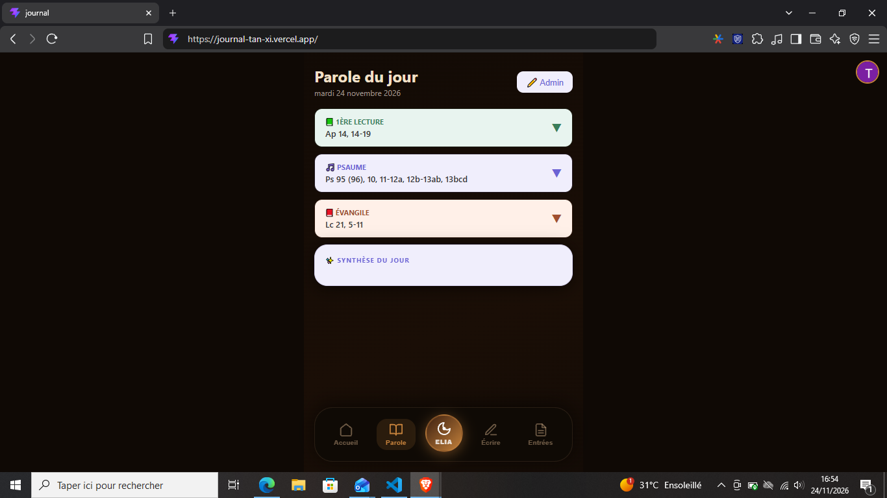
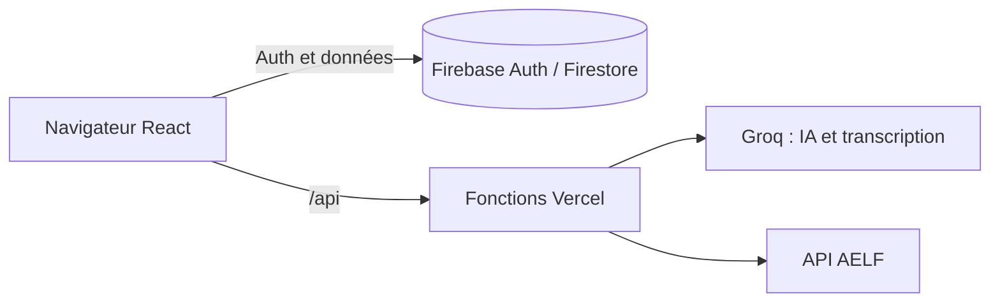

# Journal — journal spirituel avec guide IA

Journal est une application de journal intime qui aide à écrire ses réflexions quotidiennes et à organiser ses journées en leur donnant une place dans sa vie spirituelle.

**Démo :** [journal-tan-xi.vercel.app](https://journal-tan-xi.vercel.app)

## Captures d'écran

### Accueil



### Parole du jour


## Fonctionnalités

- Connexion avec Google et stockage des entrées dans Firestore, séparées par utilisateur
- Écriture et consultation des entrées du journal
- Assistant conversationnel IA (ELIA)
- Bilan spirituel périodique (« Wrapped »)
- Objectifs et planning, avec tâches ponctuelles ou récurrentes
- Lectures liturgiques du jour et prières contextualisées
- Interface en français et en anglais, avec thèmes clair et sombre

## Technologies

| Partie | Technologies |
| --- | --- |
| Frontend | React, Vite, CSS |
| API | Fonctions serverless Vercel |
| Authentification et données | Firebase Authentication, Cloud Firestore |
| IA et transcription | Groq |
| Lectures liturgiques | API AELF |

Les appels aux services IA passent par les fonctions `/api` afin que la clé Groq reste côté serveur. Les paramètres Firebase préfixés par `VITE_` sont intégrés au frontend ; configurez les règles de sécurité Firestore et les domaines autorisés dans Firebase.

## Lancer le frontend en local

Prérequis : Node.js et npm.

```bash
git clone https://github.com/Alexis102005/Journal.git
cd Journal
npm install
npm run dev
```

Le serveur Vite lance le frontend. Les fonctions `/api` étant hébergées par Vercel, leur exécution locale nécessite également l'environnement et les variables décrits ci-dessous.

### Variables d'environnement

À configurer dans l'environnement de déploiement (par exemple dans les paramètres du projet Vercel) :

| Variable | Utilisation |
| --- | --- |
| `VITE_FIREBASE_API_KEY` | Configuration Firebase côté frontend |
| `VITE_FIREBASE_AUTH_DOMAIN` | Configuration Firebase côté frontend |
| `VITE_FIREBASE_PROJECT_ID` | Configuration Firebase côté frontend |
| `VITE_FIREBASE_STORAGE_BUCKET` | Configuration Firebase côté frontend |
| `VITE_FIREBASE_MESSAGING_SENDER_ID` | Configuration Firebase côté frontend |
| `VITE_FIREBASE_APP_ID` | Configuration Firebase côté frontend |
| `GROQ_KEY` | Accès aux fonctions IA et de transcription côté serveur |
| `ADMIN_PASSWORD` | Mot de passe utilisé par la fonction d'administration |

Ne publiez jamais `GROQ_KEY` ou `ADMIN_PASSWORD` dans le dépôt. Les valeurs `VITE_` sont exposées dans l'application côté navigateur et ne doivent pas contenir de secrets.

## Architecture



## À propos du projet

C'est mon premier gros projet, réalisé avec l'aide de l'IA. J'y ai énormément appris et j'ai vraiment essayé de comprendre chaque partie de ce que je construisais, plutôt que de simplement reprendre des solutions sans en saisir le fonctionnement. Ce projet m'a notamment appris à migrer le stockage du navigateur vers Firestore et à tenir compte des limites de durée des fonctions serverless lors du traitement audio.

## Auteur

**Alexis Atindehou** — étudiant en génie logiciel (ISI-SUPTECH / UNCHK), Dakar  
GitHub : [@Alexis102005](https://github.com/Alexis102005)

## Limites connues

- La transcription audio n'est pas fiable (modèle gratuit peu précis, taille des requêtes limitée sur Vercel).
- ELIA peut ajouter des tâches au calendrier, mais la détection de conflits et la priorisation ne sont pas terminées.

## Prochaines étapes

- Vérifier le jeton Firebase dans les fonctions `/api` et limiter les requêtes par utilisateur
- Ajouter des tests